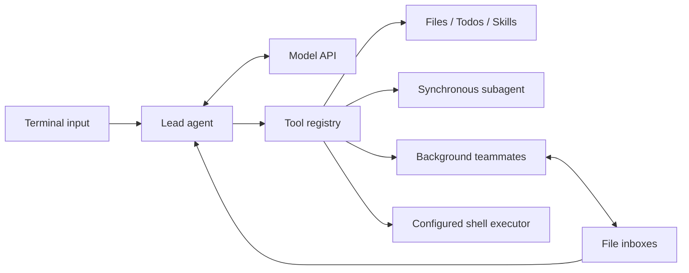

# EasyAgentic

[](https://github.com/crouchggj/EasyAgentic/actions/workflows/tests.yml)

A lightweight Python framework for experimenting with LLM agents: tool execution,
multi-agent collaboration, task budgets, sandboxed shell access, and checkpoint recovery.

EasyAgentic runs in your terminal using an OpenAI-compatible Chat Completions endpoint.
It is an experimental project inspired by
[shareAI-lab/learn-claude-code](https://github.com/shareAI-lab/learn-claude-code).

## What you can do

- **Use tools:** read workspace files, manage Todos, and load Markdown skills on demand.
- **Delegate work:** run synchronous subagents or background teammates that exchange messages.
- **Control execution:** limit rounds, tokens, estimated cost, elapsed time, and teammate count.
- **Resume tasks:** restore conversation and Todo checkpoints without automatically replaying tools.
- **Inspect activity:** view task IDs, outcomes, usage, retries, and latency in structured logs.
- **Run shell commands deliberately:** enable Docker isolation or explicitly opt into local execution.

Shell execution is **disabled by default**. Reading files, skills, and model conversations
work without enabling it.

## Quick start

Requires **Python 3.10+** and a model API credential. Run commands from the repository root.
Docker is optional unless you want isolated shell execution.

### macOS / Linux (Bash)

```bash
git clone https://github.com/crouchggj/EasyAgentic.git
cd EasyAgentic
python3 -m venv .venv
source .venv/bin/activate
python -m pip install -r requirements.lock

# Read the credential without echoing it or putting its value in shell history.
read -rsp 'API key: ' OPENAI_API_KEY
export OPENAI_API_KEY
printf '\n'
python main.py
```

### Windows PowerShell

```powershell
git clone https://github.com/crouchggj/EasyAgentic.git
Set-Location EasyAgentic
python -m venv .venv
.\.venv\Scripts\python.exe -m pip install -r requirements.lock

$env:OPENAI_API_KEY = [System.Net.NetworkCredential]::new('', (Read-Host 'API key' -AsSecureString)).Password
.\.venv\Scripts\python.exe main.py
```

You can also supply `OPENAI_API_KEY` or `EASYAGENTIC_API_KEY` through an environment manager.
Never commit credentials. For another compatible provider, set `OPENAI_URL` and
`EASYAGENTIC_MODEL` before starting. Defaults are `https://api.openai.com/v1` and `gpt-4o`.

Try a task that needs no shell access:

```text
You: Read README.md and explain this project's architecture.
```

See [.env.example](.env.example) for configuration examples. The application reads
process environment variables; it does **not** automatically load `.env` files.

## How it works



| Tool | Purpose |
| --- | --- |
| `read_file`, `todo`, `skill` | Read workspace files, track tasks, and load skill instructions |
| `bash` | Execute a command under the operator's shell policy |
| `task` | Delegate a synchronous subtask; subagents cannot recursively delegate |
| `spawn`, `send`, `read_inbox` | Start teammates and exchange messages |
| `team_status`, `team_wait` | Inspect progress and collect retained results |
| `team_cancel`, `team_resume` | Stop a teammate or explicitly resume its checkpoint |

Teammates make no model requests while idle. Before finalizing, the lead waits for
working teammates and asks the model to incorporate delivered results. A bounded wait
that expires leaves the task explicitly marked as pending. `team_wait` does not drain
inboxes, and `team_status` includes task IDs, outcomes, and results.

## Interactive commands

| Command | Effect |
| --- | --- |
| `quit`, `exit`, `q`, or EOF | Cancel teammates, clean up shell processes, and close the model client |
| Ctrl-C during a task | Cancel the task and its descendants while retaining the checkpoint |
| `/reset` | Stop teammates, drain the lead inbox, and clear lead conversation and Todo state |
| `/resume` | Restore the saved lead conversation and Todos |
| `/continue` | Continue the current in-memory conversation with a new task budget |
| `/team-resume NAME` | Restore a stopped teammate with a new task budget |

After restarting the application, use `/resume` followed by `/continue` to continue a
saved lead task. Teammate threads do not restart automatically.

## Configuration

The settings in this table use the **`EASYAGENTIC_` prefix**. For example,
`MAX_ROUNDS` means `EASYAGENTIC_MAX_ROUNDS`.

| Setting | Default | Controls |
| --- | --- | --- |
| `MODEL` | `gpt-4o` | Model identifier |
| `MAX_ROUNDS` / `SUBAGENT_ROUNDS` | `50` / `30` | Model rounds per lead/teammate cycle and synchronous subtask |
| `MAX_TOKENS` | `200000` | Shared input/output reservation budget, including retries |
| `OUTPUT_TOKENS` / `CONTEXT_TOKENS` | `2048` / `16000` | Response limit and total request context budget |
| `TASK_TIMEOUT` / `API_TIMEOUT` | `300` / `30` seconds | Task deadline and per-request network timeout |
| `RETRIES` | `2` | Additional attempts for transient API failures |
| `MAX_COST_USD` | `0` | Estimated cost limit; zero disables it |
| `INPUT_USD_PER_MILLION` / `OUTPUT_USD_PER_MILLION` | `0` / `0` | Provider token prices used for cost accounting |
| `TEAM_WAIT_TIMEOUT` / `MAX_TEAMMATES` | `30` seconds / `8` | Waiting and teammate concurrency limits |
| `WORKDIR` / `STATE_DIR` | `.` / `.easyagentic` | Workspace root and runtime state directory |
| `SHELL_MODE` | `disabled` | `disabled`, `docker`, or Unix-only `local` |
| `SHELL_TIMEOUT` / `SHELL_OUTPUT_BYTES` | `30` seconds / `64000` bytes | Shell timeout and bounded output; byte limit also bounds file reads |
| `DOCKER_IMAGE` | Empty | Pre-pulled shell image pinned by repository digest |

Additional variables have **no prefix**: `OPENAI_URL` selects the API base URL,
`SKILLS_DIR` selects skills, and `TEAM_DIR` overrides the team state path.
`MODEL` and `WORKDIR` are compatibility aliases; their `EASYAGENTIC_` forms take precedence.

### Budget and context behavior

A root task and its synchronous/spawned descendants share a token/cost ledger,
deadline, and cancellation signal. In-process messages carry their task context to
an idle teammate. Explicit continuation or resume starts a new budget: these limits
are per task, not a lifetime spending cap.

Input is conservatively estimated using UTF-8 byte bounds, with maximum output
reserved before each request. Successful API usage reports settle the reservation;
failed or unknown requests retain it. Limits may therefore stop work earlier than
actual tokenizer accounting would. Cost limits require both price settings and depend
on the rates you supply; they are not a provider billing guarantee.

Context compaction preserves system instructions, the current request, and recent
complete tool exchanges, adding bounded excerpts of older conversation. Older detail
can be lost. Oversized tool outputs are truncated; an oversized user request prompts
you to reset or shorten it. Set limits to suit your provider's model capacity.

Transient connection failures and HTTP 408/409/429/5xx responses use bounded backoff.
Authentication and parameter errors are not retried. Task cancellation can interrupt
an in-flight request without closing other agents' connections.

## Enable shell execution

The operator chooses the policy; the model cannot enable shell access.

### Docker isolation

Requires a local Docker daemon and a reviewed image containing `/bin/sh`. On Unix,
the executor uses `/var/run/docker.sock`.

```bash
docker pull alpine:3.22
export EASYAGENTIC_DOCKER_IMAGE="$(docker image inspect alpine:3.22 --format '{{index .RepoDigests 0}}')"
export EASYAGENTIC_SHELL_MODE=docker
python main.py
```

The executor requires a `repository@sha256:...` digest and uses `--pull=never`.
Containers have no network, a read-only root filesystem, dropped capabilities,
CPU/memory/PID limits, bounded temporary storage, and no mounted Docker socket.
Only the configured workdir is mounted read-write. On Unix, commands use the host UID/GID.
Application credentials are not passed through, and proxy variables are cleared.

Commands can access **all files in the mounted workdir**. Keep credentials and sensitive
host files outside it. Install required tools into the reviewed image beforehand;
network-dependent commands will not work inside this sandbox. Alpine is a minimal
example, not a complete Python development image.

### Local execution

On Unix, `EASYAGENTIC_SHELL_MODE=local` explicitly enables commands with the application's
OS permissions. It sets the working directory and strips credential variables, but
provides **no filesystem or network isolation**. Windows local mode is disabled; use Docker.

Both modes bound output and clean up process trees or containers on timeout and
cancellation, including background children whose original shell has exited.

## Checkpoints and logs

Default runtime files live under `.easyagentic/` and are ignored by Git:

| Path | Contents |
| --- | --- |
| `session.json` | Lead conversation, Todos, and checkpoint status |
| `team/config.json` | Member roles, prompts, task IDs, outcomes, and retained results |
| `team/tasks/` | Teammate conversation and Todo checkpoints |
| `team/inbox/` | File-based message inboxes |
| `events.jsonl` | Task/parent IDs, latency, retry status, usage, and configured cost estimates |

Checkpoints use atomic replacement; inbox operations use portable file locks.
Run **one teammate manager per team directory**. Restoration retains completed tool
results and marks incomplete calls as interrupted instead of automatically rerunning
them. Inspect interrupted actions before retrying: side effects may already have occurred.

Recovery does not guarantee exactly-once execution. A crash between inbox consumption
and checkpointing can lose an in-memory delivery; retained teammate results remain
available through `team_status`.

Event logs omit prompts, tool arguments/results, credentials, and API error bodies.
Checkpoints contain conversation and tool results, which may be sensitive. Protect
the state directory and manage its retention; logs are not automatically rotated.

## Tests and CI

Run the default suite without API credentials or Docker:

```bash
python -m pip check
python -m unittest discover -s tests -v
```

Coverage includes budgets, tool-call protocol, context compaction, recovery, concurrent
messaging, teammate controls, shell policy, and real SDK requests against a local HTTP
fixture, including cancellation and 429 retries. Windows skips Unix local-shell tests.

For real Docker checks, use a pre-pulled pinned image:

```bash
export EASYAGENTIC_TEST_DOCKER_IMAGE="$EASYAGENTIC_DOCKER_IMAGE"
python -m unittest discover -s tests -p test_docker.py -v
```

For a small, billable live model check, configure credentials and explicitly opt in:

```bash
EASYAGENTIC_RUN_LIVE=1 python -m unittest discover -s tests -p test_live.py -v
```

Skipped checks do not establish integration readiness. Opting into the live test
without a credential fails the test.

[GitHub Actions](.github/workflows/tests.yml) runs Python 3.10, 3.12, and 3.13 on Ubuntu
and Windows, plus Docker isolation on Ubuntu. The manually dispatched `live-model`
job requires `MODEL_API_KEY` in the `model-integration` GitHub environment; its optional
`MODEL` variable selects the model.

## Project layout

```text
main.py             CLI and lead Agent loop
agent_runtime/      Settings, budgets, model client, checkpoints, and telemetry
tools/              Tool registry, handlers, subagents, and teammate coordination
skills/             Markdown workflows loaded on demand
tests/              Regression and integration tests
requirements.lock   Exact dependency versions
```

To upgrade dependencies, update `requirements.txt` deliberately, resolve in a fresh
virtual environment, regenerate `requirements.lock`, and run the tests before committing.
