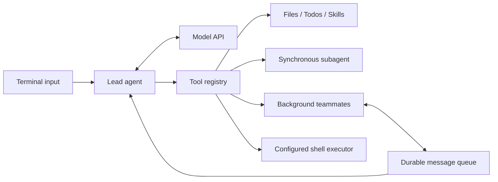

# EasyAgentic

[](https://github.com/crouchggj/EasyAgentic/actions/workflows/tests.yml)

A lightweight Python framework for experimenting with LLM agents: tool execution,
multi-agent collaboration, task budgets, sandboxed shell access, and checkpoint recovery.

EasyAgentic runs in your terminal using an OpenAI-compatible Chat Completions endpoint.
It is an experimental project inspired by
[shareAI-lab/learn-claude-code](https://github.com/shareAI-lab/learn-claude-code).

## Learn Agentic step by step

Start with the [learning guide](docs/learning.md). You can study the basic loop
before reading the complete application's recovery and concurrency mechanisms.

| Stage | Read or run | Learn |
| --- | --- | --- |
| 1. Tool loop | [Minimal read-only agent](examples/basic_agent.py) | Messages, tool schemas, tool calls, and result feedback |
| 2. Delegation | [Synchronous subagent](easyagentic/agents/subagent.py) | A separate context and a bounded subtask |
| 3. Collaboration | [Teammates](easyagentic/agents/teammates.py), [tool adapters](tools/collaboration.py) | Background work, communication, and result collection |
| 4. Reliability | [Runtime](agent_runtime/), [application reference](docs/operations.md) | Review, budgets, cancellation, checkpoints, and delivery recovery |

After installing dependencies and configuring credentials as below, run the first
lesson from the repository root:

```bash
python -m examples.basic_agent "Read README.md and summarize this project."
```

This example exposes only bounded workspace file reading. It does not construct
the full application or start teammates. Its model calls use your configured API
and can incur charges; [its tests](tests/test_basic_example.py) run offline.

## What you can do

- **Use tools:** read workspace files, propose reviewed file edits, manage Todos, and load Markdown skills on demand.
- **Review changes first:** inspect file diffs and shell commands, then approve or reject exact operations.
- **Delegate work:** run synchronous subagents or background teammates that exchange messages.
- **Control execution:** limit rounds, tokens, estimated cost, elapsed time, and teammate count.
- **Resume tasks:** restore conversation and Todo checkpoints without automatically replaying tools.
- **Inspect activity:** view task IDs, outcomes, usage, retries, and latency in structured logs.
- **Run shell commands deliberately:** enable Docker isolation or explicitly opt into local execution.

Shell execution is **disabled by default**. Reading files, skills, and model conversations
work without enabling it.

## Quick start

Requires **Python 3.10+** and a model API credential. Run commands from the repository root.
Docker is optional unless you want isolated shell execution.

### macOS / Linux (Bash)

```bash
git clone https://github.com/crouchggj/EasyAgentic.git
cd EasyAgentic
python3 -m venv .venv
source .venv/bin/activate
python -m pip install -r requirements.lock

# Read the credential without echoing it or putting its value in shell history.
read -rsp 'API key: ' OPENAI_API_KEY
export OPENAI_API_KEY
printf '\n'
python main.py
```

### Windows PowerShell

```powershell
git clone https://github.com/crouchggj/EasyAgentic.git
Set-Location EasyAgentic
python -m venv .venv
.\.venv\Scripts\python.exe -m pip install -r requirements.lock

$env:OPENAI_API_KEY = [System.Net.NetworkCredential]::new('', (Read-Host 'API key' -AsSecureString)).Password
.\.venv\Scripts\python.exe main.py
```

You can also supply `OPENAI_API_KEY` or `EASYAGENTIC_API_KEY` through an environment manager.
Never commit credentials. For another compatible provider, set `OPENAI_URL` and
`EASYAGENTIC_MODEL` before starting. Defaults are `https://api.openai.com/v1` and `gpt-4o`.

Try a task that needs no shell access:

```text
You: Read README.md and explain this project's architecture.
```

See [.env.example](.env.example) for configuration examples. The application reads
process environment variables; it does **not** automatically load `.env` files.

## How it works



| Tool | Purpose |
| --- | --- |
| `read_file`, `todo`, `skill` | Read workspace files, track tasks, and load skill instructions |
| `write_file` | Propose a bounded UTF-8 file edit for operator diff review |
| `bash` | Execute a command under the operator's shell policy |
| `task` | Delegate a synchronous subtask; subagents cannot recursively delegate |
| `spawn`, `send`, `read_inbox` | Start teammates and exchange messages |
| `team_status`, `team_wait` | Inspect progress and collect retained results |
| `team_cancel`, `team_resume` | Stop a teammate or explicitly resume its checkpoint |

Teammates make no model requests while idle. Before finalizing, the lead waits for
working teammates and asks the model to incorporate delivered results. A bounded wait
that expires leaves the task explicitly marked as pending. `team_wait` does not drain
inboxes, and `team_status` includes task IDs, outcomes, and results.

## Full application reference

The full application adds operator review, task budgets, background collaboration,
and recovery. Consult these when you reach the corresponding learning stage:

- [Commands and operator review](docs/operations.md#interactive-commands)
- [Configuration and budgets](docs/operations.md#configuration)
- [Shell execution](docs/operations.md#enable-shell-execution)
- [Checkpoints, message delivery, and logs](docs/operations.md#checkpoints-and-logs)
- [Tests and CI](docs/operations.md#tests-and-ci)

Run the default regression suite without API credentials or Docker:

```bash
python -m unittest discover -s tests -v
```

## Project layout

```text
main.py             Compatible script entry point
easyagentic/        Application assembly, CLI commands, and agent orchestration
agent_runtime/      Settings, budgets, model client, checkpoints, and telemetry
tools/              Tool registry, handlers, and compatibility exports
skills/             Markdown workflows loaded on demand
tests/              Regression and integration tests
requirements.lock   Exact dependency versions
```

From the repository root, `python -m easyagentic` also starts the CLI.
See [architecture and incremental refactoring](docs/architecture.md) for module
boundaries and compatibility guarantees.

To upgrade dependencies, update `requirements.txt` deliberately, resolve in a fresh
virtual environment, regenerate `requirements.lock`, and run the tests before committing.
